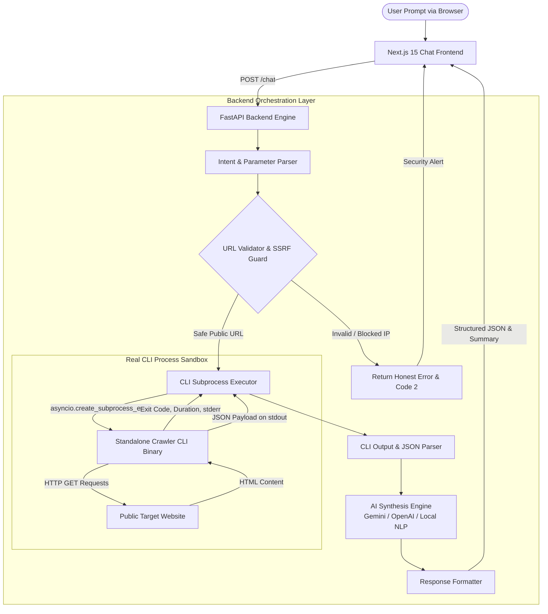
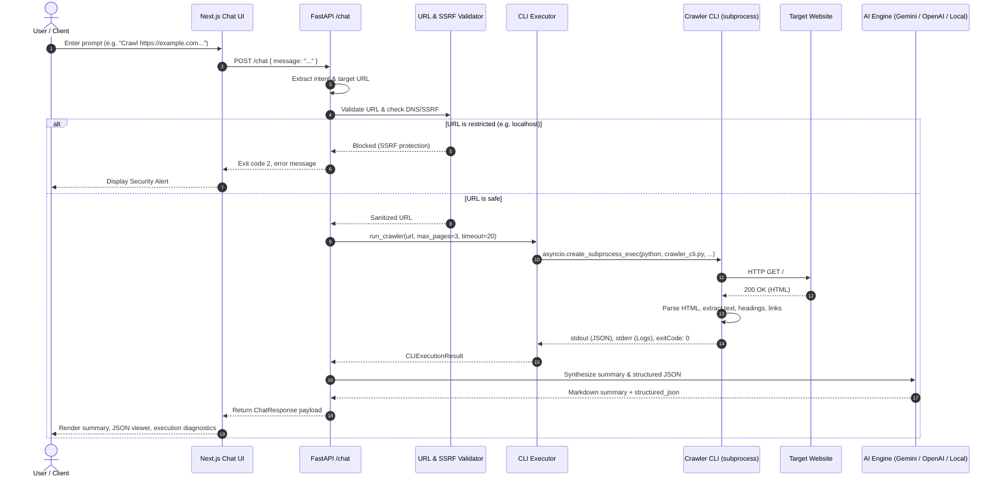
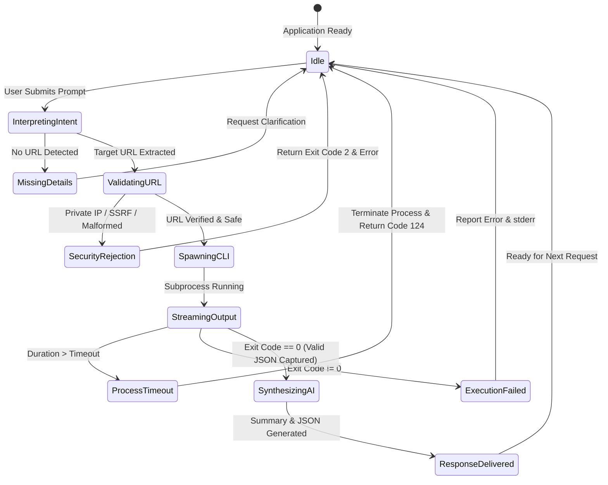

# System Architecture & Technical Specification

## 1. High-Level Architecture Overview

---

## 2. Core Components

### 2.1 Chat UI Layer (Frontend)
- **Framework:** Next.js 15 (App Router), React 19, TypeScript
- **Styling:** Tailwind CSS v4, custom cyber-dark theme
- **Markdown & Code:** `react-markdown` with `remark-gfm`
- **Key Features:**
  - Real-time execution status stepper (`intent` -> `validate` -> `cli` -> `llm`)
  - Subprocess diagnostics modal (inspect raw stdout/stderr/command)
  - One-click copy and file download for extracted JSON
  - Configurable parameters drawer (max pages, recursion depth, timeout)
  - Quick-start prompt chips for mandatory demo and security tests

### 2.2 API Orchestration Layer (Backend)
- **Framework:** FastAPI with Python 3.11+
- **Endpoints:**
  - `POST /chat` and `POST /api/chat`: Primary conversational CLI execution endpoint
  - `POST /api/chat/stream`: Server-Sent Events (SSE) streaming execution events
  - `POST /api/cli/execute`: Direct CLI execution for developer testing
  - `GET /api/health`: System diagnostics, active AI engine, and whitelist inspection
  - `GET /docs`: Interactive OpenAPI / Swagger UI

### 2.3 Intent Understanding & Parameter Extraction
- Extracts:
  - `url`: Target website URL (supports full URLs and naked domains)
  - `task`: Action type (`crawl_and_summarize`, `extract_json`, etc.)
  - `expected_output`: `summary_and_json`, `json_only`, or `summary_only`
  - `max_pages`: Requested page limit (default: 3, max: 10)
  - `max_depth`: Traversal depth (default: 1, max: 3)
- Supports external LLM extraction with deterministic heuristic fallback when offline.

### 2.4 Security & SSRF Protection
- **Scheme Whitelist:** Only `http` and `https` allowed; blocks `file://`, `ftp://`, `gopher://`, `data://`.
- **IP Address Restriction:**
  - Blocks loopback (`127.0.0.0/8`, `::1`)
  - Blocks RFC 1918 private subnets (`10.0.0.0/8`, `172.16.0.0/12`, `192.168.0.0/16`)
  - Blocks link-local (`169.254.0.0/16`)
  - Blocks cloud metadata endpoints (`169.254.169.254`, `metadata.google.internal`)
- **DNS Resolution Check:** Resolves domain via `socket.getaddrinfo` to prevent DNS rebinding attacks.

### 2.5 CLI Subprocess Executor (`services/cli_executor.py`)
- **Subprocess Spawning:** Invokes `asyncio.create_subprocess_exec` passing arguments as a list. **Never invokes `shell=True`**, eliminating shell injection vulnerabilities.
- **Binary Whitelist:** Only approved executables (`crawler_cli`, `python`, `playwright`, `crawl4ai`) are permitted.
- **Process Supervision:** Monitors stdout and stderr streams asynchronously.
- **Timeout Enforcement:** Kills child process tree if execution exceeds the configured timeout threshold.

### 2.6 Crawler CLI Tool (`services/crawler_cli.py`)
- Standalone CLI executable with `argparse`.
- Performs real HTTP requests using `httpx.Client(follow_redirects=True)`.
- Parses HTML via `BeautifulSoup4` with script/style decomposition.
- Extracts:
  - Page title, meta description, author, OpenGraph tags
  - Headings hierarchy (H1, H2, H3, H4)
  - Cleaned text content
  - Discovered links (classified into internal vs external)
  - Discovered images and alt tags
- Exit codes:
  - `0`: Success
  - `1`: Unexpected exception
  - `2`: Invalid CLI arguments / malformed URL
  - `3`: Network timeout or connection refusal
  - `4`: HTTP 4xx or 5xx response
  - `5`: Security / SSRF violation

---

## 3. End-to-End Sequence Diagram

---

## 4. State Transition Machine

