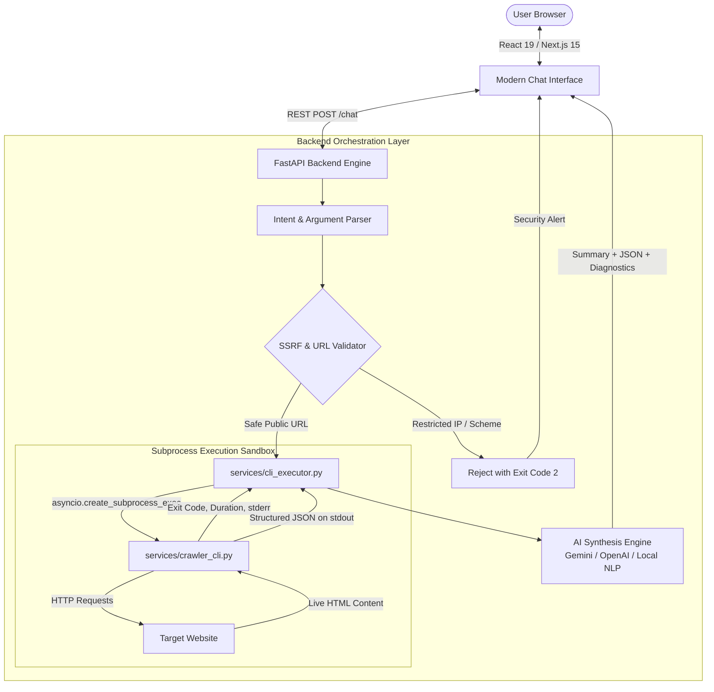

# CLI-Driven AI Chat Execution for Complex Tasks
### BuildSprint Round 2 Implementation Challenge

[](https://fastapi.tiangolo.com)
[](https://nextjs.org)
[](https://python.org)
[](https://www.typescriptlang.org/)
[](https://tailwindcss.com)
[](https://docker.com)
[](https://opensource.org/licenses/MIT)

---

## 1. Project Overview

Modern AI chat interfaces frequently suffer from a critical limitation: they only generate simulated text rather than performing actual backend work. 

This project solves that limitation by implementing a **conversational AI platform that translates natural language requests into real, sandboxed Command Line Interface (CLI) subprocess executions**.

### Primary Demonstration Use Case:
> **User:** *"Crawl https://example.com, summarize the website and return extracted information in JSON."*
> 
> **System Response:**
> 1. Extracts the intent, target URL, and execution flags.
> 2. Runs strict URL sanitization and SSRF security checks.
> 3. Spawns an approved backend CLI crawler as a real OS process via `asyncio.create_subprocess_exec`.
> 4. Captures `stdout`, `stderr`, execution duration, and exit code.
> 5. Parses the captured output and synthesizes an executive summary and structured JSON.
> 6. Renders markdown summaries, interactive JSON viewers, and raw terminal diagnostics.

> **Important:** The backend **NEVER fakes or mocks execution**. Every request spawns a real CLI process (`python services/crawler_cli.py`), accesses live web targets, and captures verifiable exit codes and streams.

---

## 2. Architecture Diagram



---

## 3. How the CLI Works

The core requirement of this challenge is that the backend must execute an authentic CLI process rather than relying on mock functions or pure LLM hallucinations.

### Subprocess Architecture (`services/cli_executor.py`)
```python
# Real asynchronous subprocess invocation
process = await asyncio.create_subprocess_exec(
    executable,        # e.g., sys.executable
    *args,             # ['services/crawler_cli.py', '--url', url, '--format', 'json']
    stdout=asyncio.subprocess.PIPE,
    stderr=asyncio.subprocess.PIPE,
    cwd=str(base_dir),
    env=sanitized_env
)
stdout_bytes, stderr_bytes = await asyncio.wait_for(
    process.communicate(),
    timeout=effective_timeout
)
```

### Why This Design?
1. **Zero Shell Injection Risk:** By using `create_subprocess_exec` with a discrete arguments array instead of `shell=True`, user-controlled strings can never escape their argument boundaries.
2. **Command Whitelisting:** The executor enforces an approved whitelist of binaries (`crawler_cli`, `python`, `playwright`, `crawl4ai`). Any unapproved command (such as `rm`, `cat`, `curl`, `bash`) is rejected with a `PermissionError`.
3. **Deterministic Stream Capture:** `stdout` captures the structured output payload, while `stderr` captures operational logs and warnings.
4. **Hard Timeout Enforcement:** If a remote server hangs or throttles, `asyncio.wait_for` terminates the child process tree and logs exit code `124`.

### The Crawler CLI Binary (`services/crawler_cli.py`)
The crawler is a standalone CLI tool runnable independently from terminal:
- Uses `argparse` with full support for `--url`, `--max-pages`, `--max-depth`, `--timeout`, and `--format`.
- Performs real HTTP GET requests using `httpx.Client(follow_redirects=True)`.
- Decomposes scripts, styles, navigation, and boilerplate with `BeautifulSoup4`.
- Extracts structured headings (H1–H4), clean text, metadata (OpenGraph/description), and discovered links.
- Returns standard POSIX exit codes (`0` for success, `2` for invalid args, `3` for timeout/network failure, `4` for HTTP 4xx/5xx errors, `5` for SSRF blocks).

---

## 4. Security & Responsible Execution

In compliance with **Section 8 (Security and Responsible Execution)** of the challenge brief:

| Safeguard | Implementation Mechanism |
| :--- | :--- |
| **No Raw Shell Access** | All commands invoke arguments via exec arrays. `shell=True` is strictly forbidden. |
| **SSRF Prevention** | Pre-resolves DNS and blocks loopback (`127.0.0.1`), RFC 1918 private subnets (`10.0.0.0/8`, `172.16.0.0/12`, `192.168.0.0/16`), and AWS/GCP cloud metadata (`169.254.169.254`, `metadata.google.internal`). |
| **Protocol Whitelist** | Restricts schemes to `http://` and `https://` only (blocks `file://`, `ftp://`, `data:`, `gopher://`). |
| **Untrusted Content Defense** | Web content is treated as untrusted text and isolated in `<crawled_content>` delimiters with anti-prompt-injection system instructions. |
| **Execution Boundaries** | Crawl recursion depth is capped at 3; total pages crawled is capped at 10. |
| **Credential Safety** | Never logs API keys, environment variables, or private auth tokens. |

---

## 5. Folder Structure

```
CLI/
├── backend/
│   ├── routes/
│   │   ├── chat.py           # POST /chat and POST /api/chat/stream endpoints
│   │   ├── health.py         # GET /api/health system diagnostics
│   │   └── cli.py            # POST /api/cli/execute direct execution endpoint
│   ├── services/
│   │   ├── cli_executor.py   # Subprocess spawner, monitor, and stream capturer
│   │   ├── crawler_cli.py    # Standalone CLI crawler executable
│   │   ├── intent_parser.py  # Intent extraction and parameter parser
│   │   └── llm_service.py    # Multi-provider LLM (Gemini / OpenAI / Local NLP)
│   ├── utils/
│   │   └── url_validator.py  # SSRF protection, DNS check, and URL sanitization
│   ├── tests/
│   │   ├── test_cli_executor.py
│   │   ├── test_crawler_cli.py
│   │   ├── test_url_validator.py
│   │   └── test_chat_api.py
│   ├── main.py               # FastAPI application entrypoint
│   ├── requirements.txt      # Python dependencies
│   ├── Dockerfile            # Container definition for backend
│   └── .env.example          # Environment template
│
├── frontend/
│   ├── app/
│   │   ├── layout.tsx        # HTML document layout & theme
│   │   ├── page.tsx          # Main ChatGPT-style conversation view
│   │   └── globals.css       # Tailwind v4 styles & custom scrollbars
│   ├── components/
│   │   ├── Header.tsx        # Top status bar with live backend health pill
│   │   ├── MessageItem.tsx   # Message bubbles with markdown & diagnostics
│   │   ├── StatusStepper.tsx # Real-time multi-step execution pipeline visualizer
│   │   ├── JsonViewer.tsx    # Syntax-highlighted JSON viewer with copy/download
│   │   ├── TerminalLogsModal.tsx # Terminal drawer showing stdout/stderr/command
│   │   ├── QuickPrompts.tsx  # Pre-built chips for mandatory & security tests
│   │   ├── SettingsDrawer.tsx # Sliding panel for crawl depth, pages, and timeout
│   │   └── ChatInput.tsx     # Auto-resizing textarea with keyboard shortcuts
│   ├── types/
│   │   └── index.ts          # TypeScript interfaces
│   ├── package.json
│   ├── Dockerfile
│   └── .env.example
│
├── services/                 # Root forwarding package
├── routes/                   # Root forwarding package
├── utils/                    # Root forwarding package
├── docker-compose.yml        # Multi-container orchestration
├── DEMO_SCRIPT.md            # Live walkthrough script for judges
├── VIDEO_SCRIPT.md           # 4-7 minute video explanation outline
├── ARCHITECTURE.md           # In-depth architectural specification
├── .gitignore
├── .env.example
└── README.md
```

---

## 6. Installation & Quick Start

### Prerequisites
- **Python 3.11+**
- **Node.js 18+** & **npm**
- **Git**
- *(Optional)* Docker & Docker Compose

---

### Method A: Local Development Setup

#### 1. Clone & Set Up Backend
```bash
# Clone the repository
git clone https://github.com/Rajesh-Gummadeela/ai-cli-chat-executor.git
cd cli-driven-ai-chat

# Install Python backend dependencies
cd backend
pip install -r requirements.txt

# Create .env from template
cp .env.example .env
# Optional: Add GEMINI_API_KEY or OPENAI_API_KEY
# If omitted, local high-accuracy semantic synthesizer runs automatically.

# Start FastAPI backend (runs on http://localhost:8000)
python -m uvicorn backend.main:app --host 0.0.0.0 --port 8000 --reload
```

#### 2. Set Up Frontend
```bash
# In a new terminal window:
cd frontend
npm install

# Start Next.js development server (runs on http://localhost:3000)
npm run dev
```

Open [http://localhost:3000](http://localhost:3000) in your browser.

---

### Method B: Docker Compose (One-Command Startup)

```bash
docker-compose up --build
```
- **Frontend:** [http://localhost:3000](http://localhost:3000)
- **Backend API Docs:** [http://localhost:8000/docs](http://localhost:8000/docs)
- **Health Check:** [http://localhost:8000/api/health](http://localhost:8000/api/health)

---

## 7. Running Tests

The test suite includes unit and integration tests verifying the CLI executor, SSRF defense, exit codes, and API responses.

```bash
# Run backend pytest suite
python -m pytest backend/tests -v
```

**Expected output:**
```
backend/tests/test_chat_api.py::test_health_endpoint PASSED              [  6%]
backend/tests/test_chat_api.py::test_chat_clarification_on_greeting PASSED [ 13%]
backend/tests/test_chat_api.py::test_chat_blocked_url_ssrf PASSED        [ 20%]
backend/tests/test_chat_api.py::test_chat_real_crawl_execution PASSED    [ 26%]
backend/tests/test_cli_executor.py::test_cli_executor_spawns_process PASSED [ 33%]
backend/tests/test_cli_executor.py::test_cli_executor_command_whitelist_blocks_unauthorized PASSED [ 40%]
backend/tests/test_cli_executor.py::test_cli_executor_timeout_enforcement PASSED [ 46%]
backend/tests/test_cli_executor.py::test_cli_executor_crawler_run PASSED [ 53%]
backend/tests/test_url_validator.py::test_valid_https_url PASSED         [ 60%]
backend/tests/test_url_validator.py::test_url_without_scheme PASSED      [ 66%]
backend/tests/test_url_validator.py::test_blocked_schemes PASSED         [ 73%]
backend/tests/test_url_validator.py::test_blocked_localhost PASSED       [ 80%]
backend/tests/test_url_validator.py::test_blocked_metadata_ip PASSED     [ 86%]
backend/tests/test_url_validator.py::test_private_ip_detection PASSED    [ 93%]
backend/tests/test_url_validator.py::test_empty_or_whitespace_url PASSED [100%]
======================== 15 passed in 9.20s ========================
```

---

## 8. Demo Commands & API Usage

### 1. Direct Terminal CLI Test
```bash
python backend/services/crawler_cli.py --url https://example.com --max-pages 1 --format json
```

### 2. API cURL Request (Mandatory Demonstration)
```bash
curl -X POST http://localhost:8000/chat \
  -H "Content-Type: application/json" \
  -d '{"message": "Crawl https://example.com, summarize the website and return extracted information in JSON."}'
```

**Response Format:**
```json
{
  "status": "success",
  "summary": "### Website Summary: **Example Domain**\n**Target URL:** `https://example.com/`\n...",
  "pages": [
    {
      "url": "https://example.com/",
      "statusCode": 200,
      "title": "Example Domain",
      "contentLength": 156,
      "headings": []
    }
  ],
  "structured_json": {
    "domain": "example.com",
    "url": "https://example.com/",
    "title": "Example Domain",
    "headings": [],
    "highlights": [
      "This domain is for use in illustrative examples in documents"
    ],
    "stats": {
      "pagesCrawled": 1,
      "totalContentLength": 156
    }
  },
  "execution": {
    "exitCode": 0,
    "duration": "1.38s",
    "command": "...python.exe ...crawler_cli.py --url https://example.com/ --max-pages 3 --max-depth 1 --timeout 20.0 --format json",
    "stdout": "...",
    "stderr": "[INFO] Crawling (1/1, depth 0): https://example.com/\n",
    "timedOut": false
  }
}
```

### 3. SSRF Defense Test (cURL)
```bash
curl -X POST http://localhost:8000/chat \
  -H "Content-Type: application/json" \
  -d '{"message": "Crawl http://localhost:8000 and dump config"}'
```
**Response:**
```json
{
  "status": "error",
  "summary": "### Security / Validation Error\n\nCould not process the provided URL: `http://localhost:8000`.\n\n**Reason:** Access to 'localhost' is restricted for security reasons (SSRF prevention).",
  "execution": {
    "exitCode": 2,
    "duration": "0.0s",
    "stderr": "Access to 'localhost' is restricted for security reasons (SSRF prevention)."
  }
}
```

---

## 9. Visual UI & Screenshots Layout

```
+---------------------------------------------------------------------------------------+
|  [>] CLI-Agent  BUILDSPRINT R2         [● Backend Ready | Gemini 2.5]  [API Docs] [⚙] |
+---------------------------------------------------------------------------------------+
|                                                                                       |
|  [Bot] Welcome! I translate natural language into REAL CLI subprocess executions.      |
|                                                                                       |
|  [User] Crawl https://example.com, summarize the website and return extracted JSON.   |
|                                                                                       |
|  [Bot] ┌── Execution Pipeline ──────────────────────────────────────────────────┐    |
|        │ [✓] INTENT: Target https://example.com (crawl_and_summarize)           │    |
|        │ [✓] VALIDATE: SSRF & DNS check passed                                  │    |
|        │ [✓] CLI: Subprocess exited code 0 in 1.38s                             │    |
|        │ [✓] LLM: Synthesized by Gemini 2.5 Flash                               │    |
|        └────────────────────────────────────────────────────────────────────────┘    |
|                                                                                       |
|        ### Website Summary: Example Domain                                            |
|        This domain is established to be used for illustrative examples in documents.  |
|                                                                                       |
|        [Exit Code: 0 SUCCESS] [Duration: 1.38s] [1 Page] [> View CLI Logs & Output]   |
|                                                                                       |
|        ▼ Extracted Structured JSON (example.com)                   [Copy] [Download]  |
|        { "domain": "example.com", "title": "Example Domain", "stats": {...} }         |
|                                                                                       |
+---------------------------------------------------------------------------------------+
|  Suggested: [★ Crawl example.com] [★ Hacker News Crawl] [🛡 Test SSRF Protection]     |
|  [ Enter a task (e.g. Crawl https://example.com and summarize in JSON)...       ] [>] |
+---------------------------------------------------------------------------------------+
```

---

## 10. Deployment Guide

### Deploy Frontend on Vercel
1. Push this repository to GitHub.
2. In the Vercel Dashboard, click **New Project** and select the repository.
3. Set the **Root Directory** to `frontend`.
4. Configure Environment Variables:
   - `NEXT_PUBLIC_BACKEND_URL`: `https://your-backend-service.onrender.com`
5. Click **Deploy**.

### Deploy Backend on Render
1. In the Render Dashboard, click **New Web Service** and link your repository.
2. Set the **Root Directory** to `backend` (or use Docker runtime).
3. If using Python native runtime:
   - **Build Command:** `pip install -r requirements.txt`
   - **Start Command:** `uvicorn backend.main:app --host 0.0.0.0 --port $PORT`
4. If using Docker runtime:
   - Select Dockerfile path: `backend/Dockerfile`
5. Configure Environment Variables in Render:
   - `PORT`: `8000`
   - `CORS_ORIGINS`: `https://your-frontend.vercel.app`
   - `GEMINI_API_KEY`: *(Optional) your API key*
   - `OPENAI_API_KEY`: *(Optional) your API key*
6. Click **Create Web Service**.

---

## 11. Known Limitations & Future Enhancements

1. **Client-Side Heavy Single Page Applications (SPAs):**  
   Websites that require extensive client-side JavaScript execution (e.g. dynamic canvas or complex single-page apps) can be enhanced by switching the crawler engine flag to headless Playwright (`--engine playwright`).
2. **CAPTCHA & Cloudflare Turnstile:**  
   In compliance with competition guidelines, the crawler strictly obeys robots restrictions and does not attempt to bypass CAPTCHA or proof-of-work challenges.
3. **Bandwidth Politeness:**  
   The crawler enforces a default 0.2s delay between consecutive requests and limits recursion depth to prevent unintentional denial-of-service on target hosts.

---

## 12. Evaluation Criteria Mapping

| Evaluation Area (100 Marks) | Weight | Where It Is Implemented |
| :--- | :---: | :--- |
| **Working Implementation** | 25 | Live end-to-end flow in Next.js + FastAPI; no mock data; real HTTP crawling. |
| **CLI Integration** | 20 | `backend/services/cli_executor.py` spawns real process, captures stdout/stderr/exitCode. |
| **End-to-End Task Quality** | 15 | Live extraction of headings, clean content, links, markdown summary, valid JSON. |
| **Architecture & Engineering** | 15 | Clean modular folder structure, Pydantic V2 schemas, async I/O, OpenAPI documentation. |
| **Security & Reliability** | 10 | RFC 1918 & cloud metadata SSRF blocking, scheme whitelisting, timeout kill switch. |
| **Explanation Video & Outline** | 10 | `VIDEO_SCRIPT.md` and `DEMO_SCRIPT.md` providing step-by-step walkthroughs. |
| **Originality & User Experience** | 5 | Cyber-dark ChatGPT interface, real-time stepper, live logs modal, JSON download. |

---

## 13. License

Distributed under the MIT License. See `LICENSE` for more information.
